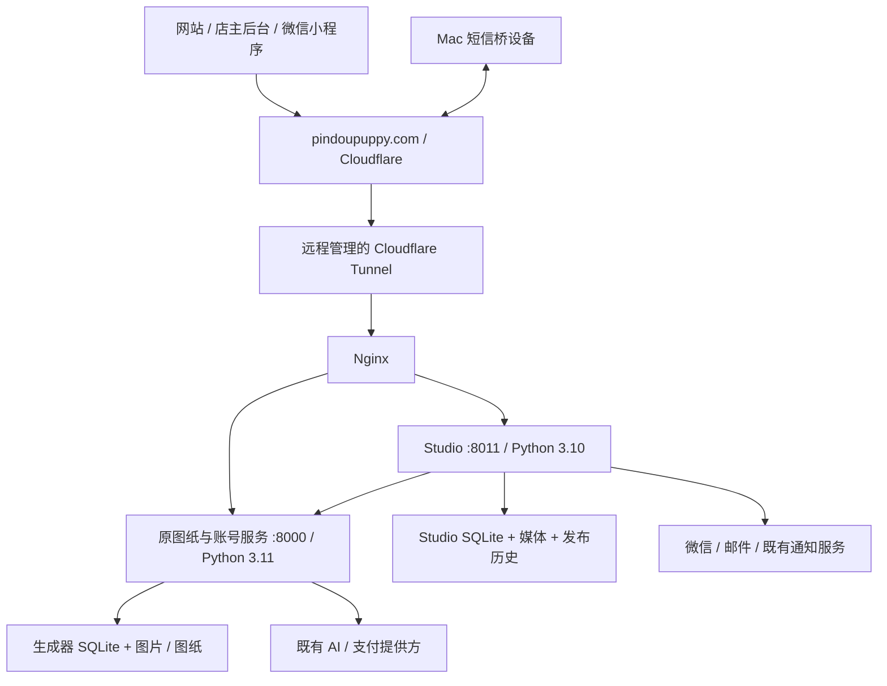

# PinDou 完整服务器迁移：现状调查与选型结论

> **历史调查快照**：本文记录迁移前只读阶段。后续已于 2026-09-18 完成迁移；当前生产 `36.139.201.94`，到期 2027-09-18。最新状态见 [服务器资产](../07_ops/SERVER_ASSETS.md) 和 [迁移验收](../07_ops/PINDOU_FULL_MIGRATION_ACCEPTANCE_20260918.md)，下文旧日期与“尚未”不代表当前仍待执行。

调查日期：2026-09-18（加东）。状态：**只读调查完成；尚未购买新机、备份全盘、同步生产、重启或切换流量。**

用户要求：服务器临近到期，先研究当前全部情况，再做全量完整迁移；参考 Turnitin 已完成迁移的聊天记录和方法。本报告覆盖网站、店主后台、小程序依赖、原有图纸服务，以及数据、文件、历史版本、配置、通知和外部设备。

## 1. 结论与时间

可以按 Turnitin 的方式迁移，但不能只搬 Studio 当前版本，也不能在两台机器上同时启动正式服务和通知任务。建议采用 **完整保全旧机资料 + 新机恢复演练 + 提前全量同步 + 短时间停止写入后同步增量 + 保持正式域名的单机切换**。

| 项目 | 当前结论 | 证据边界 |
|---|---|---|
| 旧源站 | `36.137.177.135`，主机 `ecs-37487420` | 本轮通过既有 SSH 密钥和已知主机指纹读取 |
| 到期 | **2026-09-25 22:41:52 北京时间** | 用户提供的实例通知与 `07_ops/deployment_legacy.md:28` 一致；尚未登录云账单核实是否续费/变更 |
| 对应加东时间 | **2026-09-25 10:41:52，America/Toronto** | 按该日夏令时换算；UTC 为 14:41:52 |
| 新机 | 尚未购买，用户倾向移动云 | 本轮最新用户说明 |
| 旧地区 | 既有调研记录为上海 | 本轮 OS/SSH 不能证明当前计费地区，购买前在控制台复核 |
| 迁移边界 | 保留全部现有业务数据、原有业务、历史文件、发布版本和备份 | 覆盖此前“仅迁移有效目录、限制旧版本”的小磁盘方案 |

不依赖到期后的宽限期。移动云本实例的停机、释放、快照保留条款和自动续费状态尚未取得当前控制台证据。官方搜索返回的云市场 SaaS 条款不能代替 ECS 实例条款。

建议 9 月 18–20 日确定新机和完成保全准备，9 月 20–22 日恢复演练，**争取 9 月 22–23 日切换**，余下时间观察和处理回退。此时间表是安排建议，不是已预约停机窗口；实际取决于开通、网络和演练结果。现在距离到期不足以照搬 Turnitin 的“切换后留旧机 7 天”，如必须保留完整 7 天需另行核对短续费方案，不能自行扣费。

## 2. 现场运行拓扑

| 层次 | 本轮实测 |
|---|---|
| 系统 | Ubuntu 22.04.5 LTS、x86_64、内核 5.15.0-173-generic；8 个逻辑 CPU，内存约 15.43 GiB |
| 空闲采样 | MemAvailable 约 14.45 GiB，2 GiB Swap 当时未使用；仅代表调查时刻，不能代替高峰容量测试 |
| 时间 | 系统 Asia/Shanghai，NTP/chrony 同步；预约逻辑使用 America/Toronto，迁移不能把两者混淆 |
| 生成器服务 | `pindou.service` active，127.0.0.1:8000；当前发布 `20260910015453-studio-v7` |
| 小店服务 | `pindou-studio.service` active，127.0.0.1:8011；当前发布 `20260917020325-studio-v7` |
| 当前小店包 | 415/415 manifest 文件 SHA-256 一致；公网 build 为 `2026-09-17T02:02:19.737Z` |
| 入口 | Nginx 80/443，cloudflared 2026.3.0；Tunnel 使用远程 token 配置 |
| 其他 | cron、chrony、fail2ban 在运行；没有发现正在承载 PinDou 的 Docker 或 Redis 服务 |
| 防火墙 | UFW 当前 inactive；SSH、Nginx 监听公网，应用端口仅本机。云安全组规则尚未取得，不把监听等同于公网可达 |

公网 `/health`、`/studio-api/health`、`/version.json`、`/visit`、`/shop`、`/manage`、`/tools` 本轮只读请求均为 200。它们证明当前入口响应，不证明真实登录、预约、支付或通知的完整流程。本轮没有新增预约、扣款、改积分或发送测试通知。

## 3. 必须一起迁移的资产

### 3.1 两个数据库及跨库身份

| 数据 | 现场状态（2026-09-18 UTC 04:44–04:50 分别读取） |
|---|---|
| 原图纸/账号库 | `/opt/pindou/shared/var/pindou.db`，约 45.14 MiB，17 张表，journal_mode=delete |
| Studio 库 | `/opt/pindou/studio/shared/studio.sqlite3`，约 2.61 MiB，67 张表（包含 sqlite_sequence），journal_mode=WAL |
| 完整性 | 两库 `integrity_check=ok`、外键违规均为 0；各表行数、内容摘要和表定义摘要已保存。随后另存全 schema 对象摘要：生成器 67 索引；Studio 90 索引、8 触发器 |
| 原账号/作品 | 用户 40、作品 85、CDK 301、生成任务 17、生成器订单 7 |
| 小店 | 会员 21、预约 27、商品 249、分类 21、商品来源 230、日记 12 |
| 内容历史 | 当前内容 71、内容历史 34；草稿与已发布内容都保留 |
| 钱包 | 流水 37，当前会员积分合计 4,814、时长合计 3,840 分钟；负余额、末笔流水与当前余额错配、重复幂等键均为 0 |
| 预约状态 | 待确认 1、已确认 3、已完成 11、已取消 12；管理员代建/补录来源和历史自助来源都保留 |
| 微信/身份 | 小程序绑定 8、Authing 绑定 4；Studio 会员与小程序身份到账号库的关联缺失均为 0 |

**身份连接键是账号库 `users.openid`，不是整数 `users.id`。** 保留所有稳定 ID、密码摘要、JWT/桥接密钥、管理员身份、预约归属、会员和钱包关系。不要按昵称/邮箱重建账号或重新导入用户。

逐表基线见 [DB_BASELINE_20260918.csv](migration-evidence-20260918/DB_BASELINE_20260918.csv)。这是两个分别一致的只读快照，生产当时仍持续运行，**不是最终停写后的联合迁移基线**。不能用本报告的旧行数要求迁移当天生产“恢复原样”；正式切换必须重新取冻结基线。

SQLite 结构检查和末笔余额核对不等于全部历史账本重算。本轮也未进行支付对账或逐条业务真实性审查。

### 3.2 文件、历史、运行依赖

根盘总容量约 78.56 GiB，已用 **32.49 GiB**，可用 **42.66 GiB**。没有发现另挂的业务数据盘。

| 路径/类型 | 本轮规模或用途 | 迁移要求 |
|---|---|---|
| `/opt/pindou` 全树 | 661,646 个普通文件路径；硬链接重复路径 137,969；唯一文件逻辑数据约 18.02 GiB、分配块约 19.17 GiB | 保留全部发布、共享目录、软/硬链接、所有者和权限；不只搬 current |
| 生成器历史 releases | 46 个发布目录 | 现有 venv 链实际引用六月版本，不能清除 |
| Studio 历史 releases | 74 个发布目录 | 运行包与历史回退资料都保留 |
| `studio/static-history` | 2,567 文件，约 100.66 MiB | 旧浏览器标签页的 hash 资源回退；缺失会造成旧页面 404 |
| 两套 shared + backups | 数据库、素材、密钥、导入文件、诊断、旧库和发布前快照 | 全量保留，包括 dotfile、嵌套备份、JSON 密钥文件 |
| `/var/log` | 约 5.51 GiB，包括 journal 与宿主相关日志 | 完整归档以满足保全；不直接覆盖新机正在使用的日志 |
| `/root`、`/home`、`/usr/local` | 私有配置、运维文件、工具、旧资料 | 根文件系统存量清单和独立归档纳入，确认有效配置后恢复运行 |
| `/tmp` 普通文件 | 含两个实际安装依赖 wheel | 不将整个 /tmp 视为可丢弃缓存；保全普通文件，区分 socket/PID 等瞬时对象 |
| 系统配置 | systemd/drop-in、Nginx、Tunnel、SSH、cron/timer、TLS、包版本、用户 UID/GID、字体/系统库 | 完整归档并有选择恢复；新机网卡、machine-id、cloud-init 和云厂商代理使用新机身份 |

文件验证现状：Studio 内容/日记/商品关联的 **369/369** 个本地资源存在；作品 **85/85** 预览存在，85 份图纸 JSON 均可解析；应保留的原图 **2/2** 存在。**另有 58 个原图已由原有保留策略标记删除**，完整迁移只能保全当前仍存在的数据，不能宣称本次能恢复历史已删除原图。上述内容引用检查不等于已经对全盘 66 万路径逐个做了 SHA-256。

完整保全与运行恢复分两层：全部持久文件有清单和可恢复副本；旧 OS 日志/配置/历史也在归档中。新系统不盲目启动失效服务或套用旧机器网络身份。若用户要求可启动的整机镜像，需在云控制台另核实当前账户的镜像/快照/跨地域能力及费用，再加上应用一致性数据库备份。

### 3.3 通知队列与外部设备

| 项目 | 本轮实测 | 切换要点 |
|---|---|---|
| 顾客通知 | 21 条，其中 queued 1、accepted 12、sent 7、skipped 1 | 保留待发时间、模板、接收身份、尝试、租约及幂等字段，不全部重置为待发 |
| 店主自有微信任务 | accepted 6、skipped 4 | 保留现有发送结果；迁移本身不额外消耗授权 |
| 店主微信绑定 | 本地 grants 1,391、订阅记录 1,408 | 属于本地记录，不是微信平台保证的可发送次数；不得人为重置或增大 |
| SMS | delivered 3、sent 17、unknown 1 | unknown 要保留不确定状态，不能自动补发造成重复短信 |
| Mac 桥 | customer / owner_alert 都启用，最近有 heartbeat | 心跳只证明设备轮询；设备上的持久 outbox/去重状态也要保全，切换时协调暂停/恢复 |
| 既有其他通道 | ServerChan 配置仍为启用、本站 daily_limit=5；Telegram 无绑定 | 迁移照现状保全，不擅自更换通道、购买会员或开展发送测试 |

Studio 启动会自动运行商城对账、内容导入、店主通知、Telegram 通知、店主微信和顾客通知 worker。原图纸服务启动会运行既有过期原图清理任务。**演练副本不能直接使用真实凭据启动这些任务。** Mac 桥经正式域名访问，服务端搬迁不等于设备端状态可以丢弃。

## 4. 已确认的迁移难点

| 问题 | 现场证据 | 处理方案（尚未执行） |
|---|---|---|
| 小店仍依赖旧账号服务 | Studio 管理/登录桥接到本机 8000，身份共用账号库 | 两服务和两库一起切换；不能因为小程序已移除生成页就删掉网站生成器 |
| 两套 Python 不同 | Studio 为 3.10.12；生成器实际执行 `/usr/bin/python3.11`，`--version` 为 **3.11.0rc1** | 保全原运行时与包清单，在隔离目标验证；不要只装系统默认 Python，也不在切换当场顺手升级 |
| 运行路径跨旧 release | current .venv 指向 `20260615074539-wallet-mode-labels`，uvicorn shebang/cmdline 又引用 `20260607221607-067700601ee9` | 保存全部路径链；若重建 venv，必须提前修正绝对入口并完整验收 |
| 依赖包来自临时目录 | Studio freeze 中 certifi/curl_cffi 指向 `/tmp/*.whl`，两个文件本轮均存在、已记录 SHA-256 | 另存到受控依赖包备份，重建时验证；不能直接删 /tmp 后再 pip install freeze |
| Tunnel 本地 YAML 已过时 | 运行进程使用远程 token；本地 YAML 仍是旧 xiaochisaas 域名 | 以当前 Cloudflare 配置导出为准；本轮可用 journal 没有应用配置记录，精确 ingress 导出待补 |
| 缺少已验证异机备份 | 有部署前备份；本轮 cron/timer 未发现 PinDou 定期完整异机备份 | 正式迁移前另做加密异机副本并恢复验证；云侧是否已有快照仍需控制台检查 |
| 旧失效服务自重启 | recharge-server.service enabled、目录缺失、退出 200，观察时累计重启 94,366 | 保存配置/日志并列为失效遗留项；本轮不关闭；新机不把它当有效业务自动启用 |
| 两台通知进程可能重复消费 | 启动即有后台 worker，外部设备还在轮询 | 新机演练隔离网络和凭据；正式切換冻结全部写入/消费者，保留租约与去重记录 |
| 当前目录有其他未提交改动 | 现有开发工作树不等于线上包 | 迁移从核验过的线上运行包取基线，不把工作区顺手整体发布 |

现有 TLS 源站证书为 staging 名称的自签证书（有效至 2036-05-30），公网 HTTPS 由 Cloudflare 提供。两者不是同一证书。迁移需保留源站证书/key并核对远程 Tunnel 的 TLS/Host 参数，不能在未核对参数时自行更换回源方式。

## 5. 新机配置和地区

**优先继续询价先前的移动云 8 核 16GB / 80GB / 8Mbps 档。** 这是基于用户曾提供的套餐性价比及本轮完整保全范围；不是证明业务必须要 8 核，也不是本轮已验证该套餐仍可下单。

| 维度 | 建议 | 依据与限制 |
|---|---|---|
| CPU/内存 | 4 核 8GB 有容量基础；若先前价差仍仅 55 元/年，选 8 核 16GB 更合理 | 9 月 12 日有隔离容量测试；本轮没有在生产追加压测 |
| 磁盘 | **至少 80GB，120GB 可作为低价扩容选项** | 当前整盘已用 32.49 GiB，还要留恢复副本、构建/同步和增长空间；40GB 不适合本轮完整保全要求 |
| 磁盘类型 | 优先 SSD，确认实际 IOPS/吞吐、inode、扩容能力 | 小文件数量多，不能只比较容量和 vCPU |
| 带宽 | 先按 8Mbps 询价，确认是出网/双向限速、流量包还是固定带宽 | 先前营业日志采样未证明需要立即升到 20M；本轮并未验证套餐或当前实例带宽上限 |
| 系统/架构 | Ubuntu 22.04 x86_64 作为兼容恢复基线 | 先维持现有架构；ARM、容器化、数据库换型、跨大版本升级另做项目 |
| 地区 | 上海/华东作为已知基线，比较商家可选地区的实际线路后定 | 顾客在加拿大，决定体验的是完整回源/出网线路，不能凭城市名认定某地更快 |
| 备份 | 另有一份不依附旧实例寿命的可恢复副本 | 同盘发布备份、新机本机备份都不能单独承担旧机到期后的灾备 |

9 月 12 日的历史截图报价：2C4G/40GB/3M 为 165 元/年，4C8G/60GB/3M 为 260 元/年，8C16G/80GB/8M 为 **495 元/年**；额外每 1Mbps 每月 3 元，当时估算同为 8M 的 4C8G 是 440 元/年。**新购资格、续费价、地区库存、税费、流量与磁盘规格均要以新订单核对**。本轮官方搜索未取得这个活动的当前可下单证明。

地区选择的实际办法：拿商家候选地区测试 IP/短测实例，使用同一公开静态资源和隔离动态接口，从加拿大比较延迟/丢包/下载与高峰波动，同时检查微信/Authing/邮件/支付等出站连通性。先拿这些结果，再定地区；旧机的一次探针或“更大 CPU”都不能代替该比较。不在迁移当天增加 Clash/更换跨境代理链。

## 6. Turnitin 经验：沿用什么、修正什么

已读取实际迁移报告、操作规范，以及任务 `019ff750-d44d-7703-b207-ca328e23c83d` 的 2026-08-15/16 聊天记录，不只是参考任务标题。

| 经验 | PinDou 的应用 |
|---|---|
| 先核对真实生产，再选方案 | 不把 Git 工作区、文档版本或不存在的服务当成生产 |
| 干净 Ubuntu + SSH/rsync 全量/增量 | 同架构恢复；所有业务与历史目录完整保留，系统存量另做完整保全 |
| 第一次全量迁移在旧机正常服务时进行 | 先搬不变 release 和大文件，不把几十万小文件的首次处理放到停机窗口 |
| 外部快照与逐文件验收 | Turnitin 实际核验 44,878 文件 / 37,613,893,202 B；PinDou 也需 file manifest、哈希、链接、权限，不以网页 200 代替 |
| 全部写入者冻结后最终同步 | PinDou 无实际 Redis，不照搬 Redis 指令；要包括两服务、worker、Mac 桥、支付回调、管理写入 |
| 同 Tunnel 保持正式域名 | 只在正式切换时将生产连接交给新机；保留小程序/网站域名与二维码目标 |
| 回滚区分新写入发生前后 | 一旦新机接到真实预约/支付/通知结果，必须先冻结新机并将新增状态反同步，不能直接启动旧库 |

**聊天揭示的时间教训**：Turnitin 报告用“短暂写冻结”概括切换，但实际记录中完整哈希核验曾预估 70–80 分钟，之后还遇到逐文件跨境 SFTP stat 的额外等待。PinDou 文件路径更多，应在服务器本地批量生成清单、预先核验静态历史、对 hardlink 按 inode 复用哈希；最后只对冻结后的动态差异做核验。不承诺未经演练的“零停机”或“2–5 分钟”。

选择方案比较：

| 方案 | 适用性 |
|---|---|
| 云平台整机迁移/自定义镜像 | 有助于保留特殊运行时和系统文件；本账户权限、跨区能力、费用与启动后网络身份尚未验证。Turnitin 曾被 RAM 权限挡住，不能假设 PinDou 也一定受同样限制 |
| **完整保全 + 新机恢复 + SSH 增量** | 当前已有可验证的旧机 root/SSH，流程可审计、便于预演；作为主方案。Python rc 运行时、硬链接和外部配置必须提前复现 |
| 只传仓库代码/只导数据库 | 遗漏内容、身份配置、历史静态资源与真实 venv 链，不符合本轮完整迁移目标 |

技术依据：SQLite 的备份接口可以生成一致的数据库副本，运行中的 WAL 库不应被当成普通单文件复制。[SQLite Backup API](https://www.sqlite.org/backup.html)

Cloudflare 的同 Tunnel 多 replica 都可能接到请求；因此不能把“新机提前连上同 token”当作隔离测试。[Cloudflare Tunnel availability](https://developers.cloudflare.com/cloudflare-one/networks/connectors/cloudflare-tunnel/configure-tunnels/tunnel-availability/)

rsync 的 archive 模式不自动包含硬链接、ACL 和扩展属性；迁移计划需显式考虑 `-HAX`，并验证目标文件系统及权限。[rsync 官方手册](https://download.samba.org/pub/rsync/rsync.1)

## 7. 当前仍需补齐的证据

| 缺口 | 何时补齐 | 不影响本轮调查结论的边界 |
|---|---|---|
| 云账单当前到期时间、自动续费、实例/磁盘/EIP/快照寿命 | 新机订购前登录现有控制台 | 目前按 9/25 加东 10:41 的较早确定时点安排，不假设宽限期 |
| 当前活动报价、地区、网络、存储、RAM/快照能力 | 下单前 | 495 元是历史截图价格，未购买 |
| Cloudflare 当前 ingress、DNS、TLS/Host 参数、Access/缓存设置导出 | 恢复演练前 | 已确认远程管理和现有入口健康，本机 YAML 不能当有效配置 |
| 所有外部来源 IP 白名单 | 拿到目标 IP 后 | 微信、Authing、支付、邮件、AI、对象存储等逐项查账户，不推断“域名没变就不用查” |
| 全盘持久文件清单与完整异机快照、恢复成功证明 | 同步/演练阶段 | 本轮仅收集元数据、计数和部分内容哈希，没有复制整盘备份 |
| 新机真实登录、预约/图片/积分/通知/设备链路 | 隔离演练与切换验收 | 当前健康探针不能代替；外部真实发送/消费会在明确验收范围内单独控制 |
| 停写时长、允许的维护窗口 | 演练后、最终切换前 | 不从数据总量推定；数据库很小，但历史文件路径多 |

## 8. 可复用材料和本轮证据

- [完整迁移执行手册](../07_ops/PINDOU_FULL_MIGRATION_RUNBOOK_20260918.md)：阶段、冻结边界、检查点、回退、验收记录模板。
- [机器可读摘要](migration-evidence-20260918/ASSESSMENT_SUMMARY.json)、[84 张表基线](migration-evidence-20260918/DB_BASELINE_20260918.csv)、[证据 SHA-256 清单](migration-evidence-20260918/EVIDENCE_INDEX.json)。文件不包含密钥值或顾客行记录。
- 本轮本地原始证据：`artifacts/migration-research-20260918/source-inventory.json`、`source-detail.json`、`source-business.json`、`source-followup.json`、`source-schema.json`、`public-readonly.json`；只读采集脚本同目录。原始明细为本机资料，未上传第三方。
- Turnitin 聊天摘录：`artifacts/migration-research-20260918/turnitin-chat-excerpts.json`；原记录 `D:/Users/123/.codex/sessions/2026/08/12/rollout-2026-08-12T14-51-37-019ff750-d44d-7703-b207-ca328e23c83d.jsonl`，关键行 39080、39290、39425、39536、39626、39773。
- Turnitin 文件：`C:/Users/123/Desktop/Turnitin_generation/docs/PRODUCTION_CUTOVER_2026-08-16.md`、`PRODUCTION_MIGRATION_PREPARATION_2026-08-15.md`、`PRODUCTION_OPERATIONS_AND_MIGRATION_STANDARD.md`。
- PinDou 既有记录：[历史到期信息](../07_ops/deployment_legacy.md)、[上海容量测试](PINDOU_SHANGHAI_CAPACITY_TEST_20260912.md)、[历史套餐与线路分析](PINDOU_SHANGHAI_PLAN_AND_PROXY_20260912.md)。

本轮未修改生产服务、业务配置、数据库或定时任务，未关闭失效 unit，未重新开启已停止的授权/审核自动化，未接触 Turnitin 生产服务器。详细实施要在目标机器具备、演练通过后继续。
