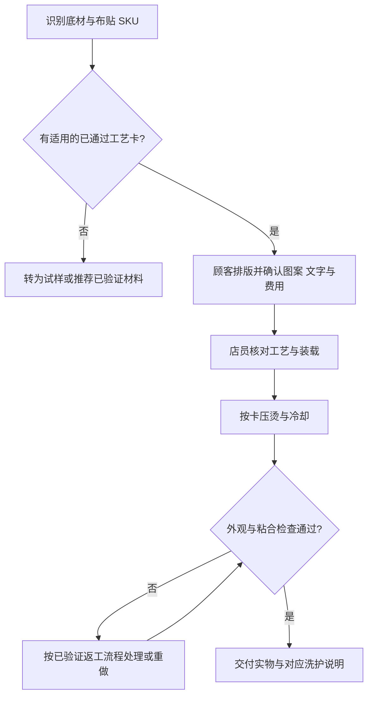

# 布贴试样、门店制作与验收 SOP

版本：2026-09-27。配套阅读：[基础知识](PATCH_KNOWLEDGE.md) · [测试卡](templates/PATCH_TEST_CARD.md)。

**状态：准备方案，尚未实测。** 下面的样本数量、复查次数和开店范围是 Pindou Puppy 的首轮建议，不是厂商标准，也不是耐久认证。

## 1. 首轮试样方案

### 1.1 建议的最小对照矩阵

| 变量 | 首轮选择 |
| --- | --- |
| 底材 | 一个棉帆布袋 SKU、一个棉质 T 恤 SKU；固定颜色与批次 |
| 布贴 | 小平面刺绣、大平面刺绣、毛巾绣各一个明确背胶的 SKU；某类无完整说明则先排除 |
| 独立样品 | 每个组合建议 3 个试片，共 2 × 3 × 3 = 18 个；这是探索性筛查，不是统计认证 |
| 空白对照 | 每种底材另留未压烫对照；比较原始色泽、手感和尺寸 |
| 样品用途 | A：压后与洗后连续观察；B：复现相同流程；C：留样或返工试验 |

平整试片用来筛工艺；通过后，还要至少在相同 SKU 的完整袋子/衣服上验证装载、接缝和穿用效果。不能用平布试片通过来证明有拉链、衬里或袋口的成品一定能做。

### 1.2 先从厂家完整流程开始

1. 取得准确商品、背胶、设备方式对应的说明；把原文链接、版本和包装照片位置写入卡。
2. 检查机器、下板、保护材料和底材耐热条件，确认流程能完整执行。
3. 按厂家流程做首样，同时记录实际设备设定和过程。
4. 首样失败时先排除错胶、错单位、错面、接缝和设备问题。
5. 确需调整时，只在厂家允许的范围内一次改变一个变量，另建一次试验记录。厂家没有给范围，就先询问，避免凭经验无限升温延时。
6. 新增底材颜色、背胶批次、设备、垫材或返工程序时，明确是否需要重新验证。

## 2. 样品怎么检查

| 时间点 | 观察与记录 | 不应据此声称什么 |
| --- | --- | --- |
| 压烫前 | 布贴边缘、底材洗标与尺寸、缺陷、表面颜色 | 外观完好不代表兼容 |
| 完全冷却后 | 翘边、移动、胶外溢、焦黄、压痕、绒面变化、背面粘连 | 此时粘牢不代表耐洗 |
| 次日及数日后 | 对比固定光线照片；观察边缘及色迁移 | 几天没变化不代表永远不变色 |
| 达到厂商规定首洗间隔后，第 1 次洗涤 | 按计划提供给顾客的洗护方式，记录水温、程序、洗剂、干燥方式与结果 | 不外推到另一种洗法 |
| 第 5 次洗涤后 | 重复同条件，量尺寸，拍边缘与正反面 | 不把 5 次变成 50/100 次耐洗声明 |
| 需要更强对外耐久声明时 | 扩大样本、次数与条件，再形成依据 | 不从试营业口碑代替测试 |

对小样可做轻折和边缘轻触比较；如做剥离破坏试验，使用指定破坏样，并记录方法。不要在尚热的胶层上用力撕拉，再把结果当作冷却后的牢度。

缩水记录：在同一标记位置量长/宽，`尺寸变化率 = (洗后尺寸 − 洗前尺寸) ÷ 洗前尺寸 × 100%`。不要用不同位置或未干透的尺寸比较。

### 建议的第一轮通过条件

- 完整成品上能重复得到正确位置、稳定边缘和可接受外观。
- 计划交付的洗护条件下，样品未出现脱落、明显翘边、不可接受掉色/染色或底材损伤。
- 底材尺寸与手感变化已经记录，并能如实告知顾客。
- 返工步骤已验证，或明确该组合不允许现场返工。
- 店员可以按工艺卡复现，不依赖某个人临场手感。

任何一项失败，将该组合标为“待调整”或“停用”；它不自动使同供应商所有其他组合失败，也不能被其他组合的通过结果掩盖。

## 3. 现场操作顺序



### A. 开始营业前

- 看本班要使用的工艺卡与停用清单；不同胶类分箱，不把散装库存混在同一标签下。
- 检查压板、垫材和保护片是否干净平整，工作台与冷却区是否可用。
- 按机器说明完成开机、预热与必要校验；不得用操作台显示数字替代均匀性检查。
- 使用已验证的电源条件，排版区与高温区分开。
- 确认当天库存、收费规则和可接底材，尤其是自带物品的处理范围。

### B. 接待与排版

1. 选空白品；自带物品先验洗标、材质、涂层、已有图案、衬里、口袋与接缝。
2. 选对应工艺组的布贴。未知来历的顾客自带贴片不直接作为成熟服务接单。
3. 用实际物品排版；说明包带、拉链等需要避开的区域。
4. 写清每种贴片数量和费用。字母/姓名逐字确认，拍下最终布局。
5. 顾客确认后交给店员；高温固定后不承诺可无痕换位。

### C. 压烫

1. 检查布贴/底材/批次与工艺卡一致；核对 °C/°F。
2. 除尘并确保干燥。需要预洗的底材必须已完成处理，不能现场用预热替代。
3. 按卡套板或承托；避免背面一起粘连，避免接缝撑高影响受压。
4. 仅移除说明要求移除的离型纸；热熔胶本身要保留。
5. 按已验证方法定位；使用指定保护层和垫材。
6. 按卡完成主压及所需翻面、复压；每一步分别计时。无此步骤就不自行添加。
7. 按要求冷却和揭离。转移时避免布贴位移，不把尚热成品直接塞进包装。

### D. 检查与交付

1. 对照排版照片：文字、方向、位置、数量一致。
2. 检查全周边缘、表面纹理、底材正反面和相邻区域。
3. 发现缺陷按“已验证返工卡”处理；没有有效返工方法就暂停，不以反复加热赌效果。
4. 交付对应洗护卡，记录作品编号、材料批次、使用工艺卡和返工情况。
5. 用完整工序耗时记录产能；不要只记录压机倒计时。

### E. 收工

按机器手册关机和冷却后清理；盘点补货、记录失败 SKU 和机器异常。返工、报废样品从可销售库存扣除。

## 4. 洗护卡模板

下面是内部填充模板，**未填完不能发给顾客**。每个通过组合可生成一份中英文版。

```text
Pindou Puppy · 布贴作品洗护
作品/工艺编号：____
首次清洗：制作后至少 ____（以该材料的确认说明填写）
清洗方式：____  水温：____
干燥方式：____
漂白 / 干洗 / 直接熨烫装饰面：____
出现翘边时，请先联系门店，并提供局部照片。

Pindou Puppy · Care instructions
Item / process reference: ____
Wait at least ____ before the first wash.
Washing method and temperature: ____
Drying method: ____
Bleach / dry-cleaning / ironing over the decoration: ____
If an edge lifts, please contact the studio with a close-up photo.
```

不要在说明未知时以模板默认值补齐。是否能洗、能否烘干与何时首洗，要同时符合底材和装饰材料。

## 5. 从样品到试营业

| 阶段 | 可交付结果 | 进入下一步的条件 |
| --- | --- | --- |
| 资料准备 | 已确认 SKU、说明、样品采购单和机器条件 | 没有关键材料未知项 |
| 工艺试样 | 测试卡、失败照片、可复现组合 | 通过本轮接受条件 |
| 店员试跑 | 完整作品、真实耗时、耗材/损耗数据 | 能按流程稳定完成 |
| 小规模体验 | 建议先约 4–6 位试体验者，收集排版、等待和价格反馈 | 人数是试行建议，不是已确认预约 |
| 正式服务 | 实际菜单、洗护、物料和库存规则 | 成本和产能成立，外部文案与证据一致 |

## 6. 必须保留的记录

每次试验复制 [PATCH_TEST_CARD.md](templates/PATCH_TEST_CARD.md)，命名建议 `TEST_YYYYMMDD_贴片SKU_底材SKU_序号.md`。测试结果存入本目录的 `tests/`，实物照片可存项目素材目录并在卡中链接。

同时登记：失败原因、能否返工、耗时、供应商沟通结论及下次需验证的问题。新批次或新配方上线后更新 [索引](INDEX.md) 中“当前确认到哪一步”，让后续任务能区别已测试与仍待验证。
