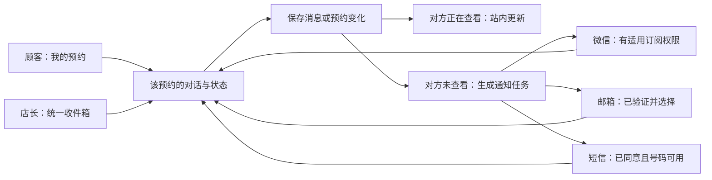

# 小狗拼豆铺：预约通知与双方沟通方案

2026-09-11。来源：店主询问能否像所附截图一样通过自有小程序收服务通知，要求顾客同时具备微信、邮箱和短信渠道，并参考成熟预约 SaaS 构思站内沟通。店主补充：**短信以加拿大为主，同时支持中国 +86**。

本轮完成官方资料研究、源码核对及自有小程序订阅模板接口的只读核验。本文是下一阶段方案；没有发送顾客消息、购买号码或套餐、配置发送模板、变更预约，也没有撤回正在审核的 0.1.7。

## 1. 可以用自己的小程序发卡片，但接收权限需要分别建立

截图是微信“服务通知”中的小程序通知卡片。我们可以采用这种入口；实际卡片身份使用微信登记的小程序名称与头像，正文按模板填写，点击进入对应预约或对话。当前登记名称仍是“双吉拼豆图纸定制”；如希望卡片统一显示“小狗拼豆铺”，须另核验并完成平台名称与头像设置，不能仅改应用内标题就宣称通知身份已变。

店主可作为消息接收者，但微信后台管理员身份不直接变成业务通知的长期接收授权。一次性订阅需要接收者主动授权；用户一次授权对应一条服务通知，“总是保持选择”不能按无限额度理解。顾客在预约或发送咨询时订阅比较自然；店主需要接收不确定时间到来的所有新单，不能把一次性订阅作为唯一通道。依据：[腾讯官方微信订阅消息实践](https://cloud.tencent.com/document/product/1301/103770)。

### 自有账号实测结果

使用当前正式配置的 AppID，服务器向微信官方 API 读取类目、已选模板和公共模板；获取稳定令牌时保持 `force_refresh=false`，没有刷新或撤销线上令牌。完整取回 **1,011** 个公共模板，账号已选模板为 **0**。

| 核验项 | 结果 |
|---|---|
| 账号所属类目 | 图片处理（302）、预约/报名（698） |
| 公共模板类型原始值 | type=2 共 861 个；type=4 共 150 个；没有 type=3 |
| 店主新预约候选 | 26378「新预约审核通知」，type=2 |
| 顾客确认候选 | 984「预约成功通知」，type=2 |
| 顾客取消候选 | 986「预约取消通知」，type=2 |
| 对话回复候选 | 48305「留言回复通知」、3452「咨询回复通知」，type=2 |

已进一步读取 26378、984、986、48305、44423 的实际关键词。拟用的预约与回复模板确实存在，不需要猜测公共模板标题。**标题存在不等于已获得发送权限**：仍要组合字段、保存到账号模板库、前端订阅、服务端投递并真机收件验收。

部分原始记录为 type=4。腾讯原生文档本轮抓取失败，未核实该类型的完整新规则；不把它解释为无限期订阅，不把它作为绕开用户授权的依据。当前也没有证据表明本账号已具备店主永久接单提醒能力。腾讯云 Superapp 产品文档描述的是另一个产品，不能拿其后台权限表代替微信小程序规则。

只读证据：`artifacts/messaging-design/wechat-template-capabilities.json`、`wechat-template-keywords.json`。检查时间分别为 2026-09-11 13:55:48 UTC、14:00:05 UTC；凭据留在服务器，没有写入报告。

### 建议接收方式

- **店主**：自有小程序订阅通知 + 邮箱；保留 Server 酱或待恢复的 Telegram 为持续提醒渠道。某渠道额度或授权不可用时，后台明确提示并走可用备选，不把待发当成已收。
- **顾客**：微信、邮箱、短信均支持，在账号内选择，可多选。预约确认和取消等关键事件按已选择且已验证的渠道发送。
- 订阅被拒绝、号码没填、发信服务故障，都不应导致有效预约提交失败。

## 2. 必须补齐小程序里的店长入口

现在小程序主要是顾客首页、预约和账号界面。要实现“收到卡片 → 点击处理”，还需增加只向已绑定店长显示的 **店长工作台**：待确认预约、未读对话、查看预约、确认或拒绝、对外回复。

绑定由现有网站管理员会话发起，使用短期一次性绑定凭据在店长微信中确认；后台保存授权的业务账号和小程序身份。微信平台的管理员身份、顾客账号和网站管理员权限是不同层次，不按微信昵称或手机号猜测店长身份。

通知链接只定位预约或会话，不授予管理权；打开时仍校验店长权限。确认预约继续走既有容量、状态版本及幂等检查。换成女朋友接收时，变更授权的收件人即可，客户预约与账号不需要迁移。

## 3. 参考哪些 SaaS，采用哪些做法

| 产品 | 官方可见做法 | 在本项目采用 |
|---|---|---|
| Square Appointments | 预约确认、请求、变化、取消与提醒可按顾客偏好用邮件或短信；其 App 推送与短信有避免重复的安排 | 统一事件、渠道偏好、重要通知与普通聊天区分。见 [预约通知](https://squareup.com/help/us/en/article/6729-customer-confirmations-with-square-appointments) |
| Wix Bookings / Inbox | 待审批、批准、拒绝、取消、到访提醒分开；收件箱集中回复并支持快捷回复、成员权限 | 提交成功与预约成功分开；店长从一个收件箱处理。见 [预约短信](https://support.wix.com/en/article/sending-sms-reminders-to-clients-in-wix-bookings)、[Inbox](https://support.wix.com/en/article/wix-inbox-an-overview) |
| Airbnb | 按每次预约查看消息时间线，模板可填入预约资料，按事件及房源时区安排回复 | 每笔预约保留上下文，按 Toronto 时区安排到访提醒，允许取消过时的待发提醒。见 [快捷回复](https://www.airbnb.co.uk/help/article/2897) |
| Chatwoot | 统一收件箱、私密备注、快捷回复、负责人、会话状态 | 对外回复与私密备注明确区分；已处理对话可重新打开。见 [Shared Inbox](https://www.chatwoot.com/features/shared-inbox) |

建议在现有 Vue / uni-app / FastAPI 系统上实现精简的预约对话，继续使用现有账号和后台。暂不另部署完整客服平台；未来多人轮班、多个社交渠道、复杂工单需求出现时，再评估 Chatwoot。这个选择是结合当前一间工作室的工程判断。

## 4. 顾客与店长看到的界面

### 顾客端

“我的预约”的每张卡片增加 **联系店长**，有新消息时显示小圆点或数量。进入后：

1. 顶部紧凑显示日期、时段、人数与预约状态，可展开详情。
2. 中间是消息记录，穿插“店长已确认预约”等真实系统事件。
3. 底部固定输入栏和发送按钮，草稿按账号及预约保存；键盘弹起仍可输入和发送。
4. 需要时点击“接收回复提醒”，触发适用微信模板的订阅；邮箱和短信选项从个人设置复用。

不重复询问已经保存的称呼或联系方式。先交付文字、系统事件和快捷回复；图片属于下一项明确排期，用于发想拼的图案、停车位置等，采用受控附件存储与按会话访问校验。语音、视频、AI 自动代答不进入本轮基本方案。

### 店长端

网站后台增加 **消息** 入口，预约列表也显示最后一条消息与未读标记。桌面采用“会话列表 / 对话 / 可折叠预约资料”；手机一次显示一个层级，输入栏常驻。筛选仅保留“待我回复、全部、已处理”，临近到店且未处理的预约可排前。

- 对话上方可直接打开原预约详情、确认或取消；修改预约与发送聊天是两个明确动作。
- 发送区提供 **回复顾客 / 内部备注**，两种状态有清楚文字及颜色区分。现有私密备注不会复制为顾客消息。
- 快捷回复建议包括停车、到达楼下、稍晚到等常用情况；只作为待编辑草稿，不无条件自动发送。
- 会话状态为“待店长回复 / 等待顾客 / 已处理”，独立于预约状态。已处理会话收到顾客新消息后重新进入待回复。
- 两位店长可看到谁正在处理，发送与预约操作都有记录，减少重复回复和重复确认。

## 5. 什么时间通知谁

下表是建议默认行为；客户选择多渠道时可发送多份关键通知，普通聊天避免每条都同时轰炸三种渠道。

| 事件 | 顾客 | 店长 |
|---|---|---|
| 提交预约 | 页面回执“等待确认”；邮箱收申请回执；微信确认订阅额度优先留给店长处理结果 | 立即提醒新预约待确认 |
| 店长确认 | 微信、邮箱、短信按已选择渠道通知“预约成功”，附查看入口 | 后台状态更新；不额外通知操作人自己 |
| 拒绝、取消、安排变化 | 发送准确结果；原待发提醒停止或按新安排重算 | 顾客自行取消时提醒店长 |
| 到访前提醒 | 建议提前 24 小时一次；不足 24 小时的新预约不补发过时提醒。按 Toronto 时区计算 | 当日待办可在工作台汇总 |
| 顾客新留言 | 本地显示已发出；保留自己的草稿恢复 | 站内未读，短时间连续留言合并为一条外部提醒 |
| 店长对外回复 | 站内未读；离开对话约 2 分钟仍未读时，按偏好发一条回复提醒 | 操作记录；内部备注不触发顾客通知 |

微信确认、取消与留言回复是不同模板和订阅机会，不能拿一次授权同时保证全部事件。普通聊天默认站内 + 邮件/适用微信模板；短信重点用于确认、取消、改期及用户选中的提醒，避免多轮聊天带来持续费用。

服务商“已接受”、运营商“已送达”与站内“已读”分别记录。没有可靠回执的渠道就不显示“对方已读”。短信和邮件首版通过入口回到对话；直接回复邮件/短信后自动合并到会话是独立第二阶段，尤其同一号码有多笔预约时不能猜错关联。+86 路线不承诺双向短信。

## 6. 邮箱与加拿大、中国号码方案

### 邮箱

已有账号找回代码使用 Resend，可复用发信服务与已验证发信域名配置，新增独立的预约/回复模板、投递回执、退信处理和防重复任务。通知邮箱与登录邮箱可以不同，不因修改通知邮箱就改登录身份。

Resend 当前免费档为每月 3,000 封、每天 100 封；这是套餐上限，不是本账号的剩余额度。需与验证码、找回邮件共用容量，保留登录邮件的余量。见 [Resend 定价](https://resend.com/pricing)。

### 加拿大为主

优先选 Twilio 的加拿大 A2P 通道；实际申请时核验号码类型，官方建议业务消息优先使用已验证 Toll-Free 等适用通道。支持用户同意记录、退订、发送结果和每月预算限制。仅有 +1 还不能区分加拿大与美国，号码校验需识别地区。见 [加拿大通道说明](https://www.twilio.com/en-us/guidelines/ca/sms)。

按本次加拿大官网美元价，基础发送 **0.0083/段**，常见运营商另收 **0.0064–0.0087/段**；Toll-Free 号码 **2.15/月**。以 200 个单段加拿大短信为例，合计约 **5.09–5.55 美元/月**，未计税、其他服务及超出部分。这个算例只覆盖加拿大，不包含 +86 通道。见 [Twilio 加拿大价格](https://www.twilio.com/en-us/sms/pricing/ca)。

中文/emoji 会改变编码并可能拆成多段，手机上看似一条也可能多段计费；模板按语言分别控制长度，而非每条短信都塞中英双语。见 [Twilio 计段说明](https://www.twilio.com/docs/glossary/what-sms-character-limit)。

### 中国 +86

把 +86 单独作为可路由的短信地区，优先核对正规国内短信通道与本项目真实材料能否匹配。

- 阿里云国内通知短信当前基础按量报价为 **0.045 元/条**，但签名实名流程明确要求大陆公司授权；“个人云账号能申请某些模板”不等于“个人小程序备案就满足签名条件”。见 [价格](https://help.aliyun.com/zh/sms/product-overview/billing-of-messages-sent-to-chinese-mainland)、[资质申请](https://help.aliyun.com/zh/sms/user-guide/apply-qualification)。
- 腾讯云资料仍说明个人认证可以在控制台申请签名，但需要相应材料；是否接受本账号/备案/境外工作室场景应实际核验，不能据此承诺已可使用。见 [腾讯云签名问题](https://intl.cloud.tencent.com/zh/document/product/382/13300)。
- Twilio 中国价为 **0.1082 美元/段**，其通道说明明确为尽力送达、不支持双向短信，并对正文 URL 等内容有约束。可评估为国际备选，不能当作已验收的稳定国内送达方案。见 [中国价格](https://www.twilio.com/en-us/sms/pricing/cn)、[中国通道说明](https://www.twilio.com/en-us/guidelines/cn/sms)。

顾客持 +86 号码但人在加拿大，仍按号码归属及相应通道处理，不因为手机人在加拿大就套用加拿大短信价。尚未确定国内资质前，产品结构保留 +86 支持；上线状态明确标识待开通，不能先显示“短信提醒已开启”。短信不作为长期免费服务承诺。

## 7. 资料、偏好和技术接入

当前预约资料只保存一组 `contact_method + contact`，不能从填写一个微信号自动得到可用邮箱和手机号码。增加单独的通知设置：

- 微信绑定与每类订阅状态。
- 已验证通知邮箱；已有邮箱可作为候选，但旧密码注册账号不一律视为已完成邮箱证明。
- 带国家/地区的手机号、验证/同意状态和退订状态。
- 接收事件与渠道偏好、中英文偏好。

第一次选择渠道时补资料，后续复用；不开某渠道不强迫填写对应资料。发送时只取已经建立的业务身份、预约归属和接收地址，不能靠用户提交的邮箱或电话号码认领别人历史会话。

后端继续使用既有持久通知队列的事务写入、幂等和失败退避经验，但为顾客消息明确增加接收者、事件版本、模板、通知偏好及发送结果。已有 Server 酱与 Telegram 队列、密钥和收件人配置保持可回退；预约与消息成功保存后，外部发送失败不回滚业务。

微信授权记录不把客户端一次 `accept` 回报当作永远有效或精确剩余额度；发送接口拒绝时记录需重新订阅，不循环消耗同一许可。API 密钥、openid、手机、邮件地址与正文不进入公开日志。

新消息、已读进度、系统预约事件和私密备注分别建模。聊天读取及写入验证预约 `owner_id` 或店长角色；消息发送使用客户端请求编号去重，翻页使用稳定游标，断网保留草稿。未读在对话实际可见后更新，不因收到手机推送就自动设已读。

## 8. 实施顺序及验收

1. 先补通知联系方式与偏好、公共业务事件、顾客邮件及投递记录；保留现有店主提醒。
2. 保存适用微信模板，补顾客订阅入口与店长身份绑定/工作台；用两部真实微信分别验证接收、拒绝、授权用尽、跳转和权限。
3. 同步申请加拿大短信号码/验证与 +86 所需材料；配置完成后验证加拿大主要运营商、国内 +86 和 +86 漫游场景，设置预算与退订，不用测试信用额度证明长期免费。
4. 在既有预约里实现双方文字对话、未读、快捷回复、私密备注和离线合并提醒；随后加入受控图片附件。
5. 完整测试“提交 → 店长收到 → 确认 → 顾客收到 → 留言 → 回复”，以及取消后不再提醒、跨账号隔离、重复发送、时区夏令时和发送失败。

界面沿用项目 pindou-studio-design 规范，手机/微信、320px 窄屏、横屏、低高度、软键盘及安全区均检查。长对话自然滚动，输入栏与主要动作可见，不通过缩小整页或裁掉历史凑一屏。

新微信订阅与店长页面属于下一版小程序更新。当前 0.1.7 的提审状态和已有上线授权保持，等待结果期间不无故撤审。方案中的模板、UI 和消息文案尚未发布为产品默认内容。
