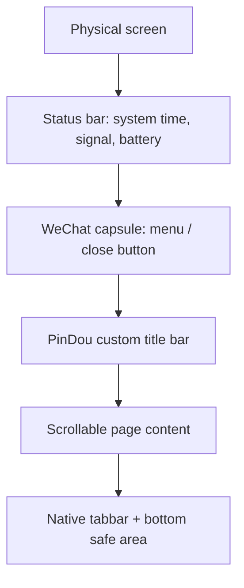

# PinDou Mobile Adaptation Notes

Date: 2026-05-25

## Scope

This note defines how PinDou mini-program pages reserve space for the status bar, the WeChat capsule menu, and bottom safe areas across simulator and real devices.

## Three Layers

Status bar: top OS chrome. Height differs by device, notch, Dynamic Island, and Android vendor skin.

WeChat capsule: the fixed right-side mini-program menu. Its top/height/width must be read at runtime with `uni.getMenuButtonBoundingClientRect()`.

Safe area: the bottom inset on iPhone X and later. On Android it is usually zero, but code must tolerate non-zero values.

## Runtime Chrome Rule

HTML wireframes may draw a fake time, signal, battery, and capsule to make static mockups look like WeChat. The mini-program runtime must not render those fake elements.

Runtime rules:

- The system status bar is native. PinDou only reads `statusBarHeight`; it does not draw time, signal, Wi-Fi, or battery.
- The WeChat capsule is native. PinDou only reserves right-side width from `getMenuButtonBoundingClientRect()`; it does not draw a second `... / x` capsule.
- Custom page titles align vertically to the native capsule and are centered with symmetrical left/right insets, so short titles such as `分区图` remain visually centered.
- Back buttons are app UI; status bar and capsule are platform UI.

This separation is mandatory for true-device debugging. Simulators and screenshots can otherwise show duplicate time / signal indicators, especially on iPhone 15 and Dynamic Island devices.

## Device Rules

Use runtime data first:

- `uni.getSystemInfoSync()` for `statusBarHeight`, `screenWidth`, `screenHeight`, `pixelRatio`, and `safeArea`.
- `uni.getMenuButtonBoundingClientRect()` for capsule `top`, `height`, `width`, `right`, and `bottom`.
- Reserve right-side title/header space equal to capsule width plus right gap, so page titles do not sit under the native WeChat capsule.
- Use `safeArea.bottom` or `safeAreaInsets.bottom` for the bottom inset; also keep `env(safe-area-inset-bottom)` in CSS for iPhone X+ style runtimes.

## rpx / px Rule

Mini-program `rpx` is based on a 750-rpx design width. The practical conversion is:

`1rpx = screenWidth / 750 px`

Examples:

| Device | CSS width | 1rpx |
| --- | ---: | ---: |
| iPhone SE | 320px | 0.427px |
| iPhone 12/13 | 390px | 0.520px |
| iPhone 14 Pro Max | 430px | 0.573px |

PinDou currently uses `px` in the Vue/WXSS surface because the imported wireframes were px-based. For Phase 2, top chrome and safe areas are runtime px; future component spacing can move to rpx when the design system is normalized.

## Implementation Formula

In `App.vue`, initialize metrics at launch and store them in Pinia:

- `statusBarHeight = systemInfo.statusBarHeight || 20`
- `menuButton = getMenuButtonBoundingClientRect()` with a conservative fallback
- `topChromeHeight = max(statusBarHeight + menuButton.height + 8, menuButton.bottom + 8)`
- `capsuleReserveRight = max(screenWidth - menuButton.left + 12, 104)`
- `safeAreaBottom = screenHeight - safeArea.bottom`

In `MiniProgramLayout`, expose these values as CSS variables:

- `--pd-status-height`
- `--pd-menu-top`
- `--pd-menu-height`
- `--pd-top-chrome-height`
- `--pd-safe-bottom`
- `--pd-capsule-reserve`

The custom title row aligns to the real capsule's vertical position, while the title text reserves right-side width for the native capsule.

## Target Checks

| Device | Viewport | Expected behavior |
| --- | ---: | --- |
| iPhone SE | 320x568 | Header title remains readable; content scrolls; bottom footnote stays above safe area/tabbar. |
| iPhone 12/13 | 390x844 | Header aligns with capsule; upload title is not covered by the native menu. |
| iPhone 14 Pro Max | 430x932 | Dynamic Island/status bar does not overlap title; bottom safe area remains clear. |

## Image And Pattern Preview Rule

Generated pattern images are remote static files served by the backend. On true devices, image loading can fail because of LAN reachability, HTTP/domain checks, stale generated paths, or oversized image decoding.

Runtime rules:

- Every generated `<image>` preview must listen for `@error`.
- If the full PNG cannot load, result pages fall back to the stored `PatternSheet.grid` and render an inline grid preview instead of leaving a blank white box.
- Partition cards also fall back to a sliced mini-grid from the stored PatternSheet.
- `uni.previewImage()` should only be called for URLs that are known to have loaded; otherwise show a small toast and keep the inline preview visible.
- Test both simulator and true-device debugging because URL check and LAN reachability differ between the two.

## Full-Resolution Test Matrix

Each UI change that touches layout or generated images should be checked at these widths:

| Class | Width | Required checks |
| --- | ---: | --- |
| Compact | 320px | Title does not overlap back button; two-column cards remain readable. |
| Standard | 375-390px | Main happy path; pattern image / grid fallback; native capsule clear. |
| Large iPhone | 430px | Dynamic Island does not duplicate with app UI; title remains centered. |
| Tall Android | 360-412px | Safe area bottom can be zero; content still scrolls to last CTA. |

For generated assets, check:

- `26x26`: full preview and 4 partition cards visible.
- `52x52`: full preview visible; partition cards may use image or inline-grid fallback.
- `78x78 / 104x104`: page thumbnail should remain lightweight; full detail is viewed through native preview when the image URL loads.

## References

- uni-app CSS, safe area, and rpx: https://uniapp.dcloud.net.cn/tutorial/syntax-css.html
- uni-app system info API: https://uniapp.dcloud.net.cn/api/system/info.html
- uni-app menu button API: https://uniapp.dcloud.net.cn/api/ui/menuButton.html
- WeChat Mini Program `wx.getMenuButtonBoundingClientRect`: https://developers.weixin.qq.com/miniprogram/dev/api/ui/menu/wx.getMenuButtonBoundingClientRect.html
